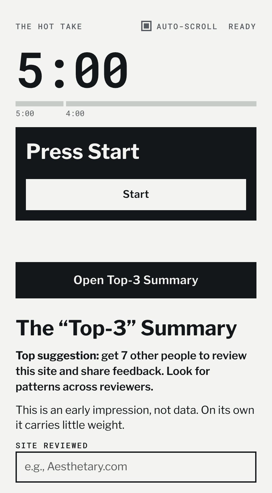
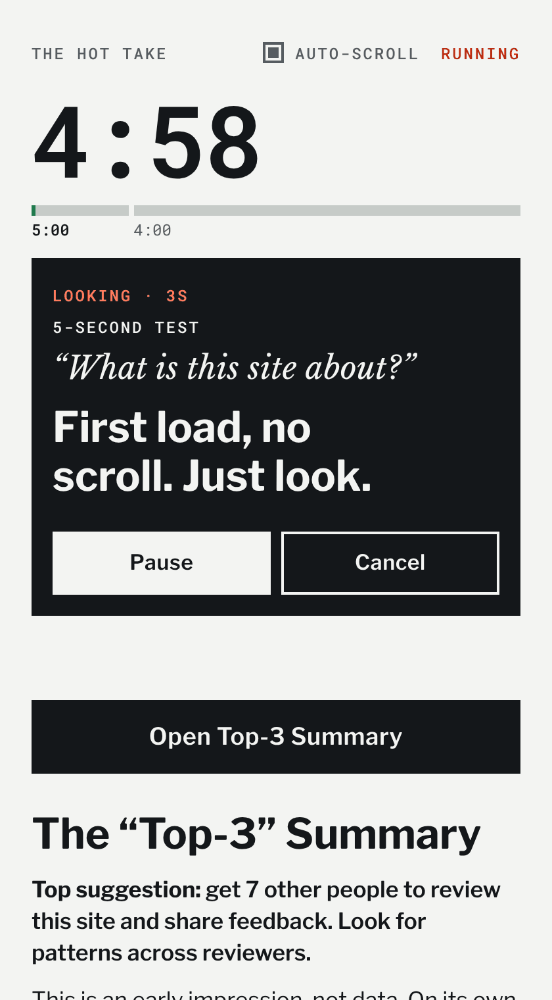
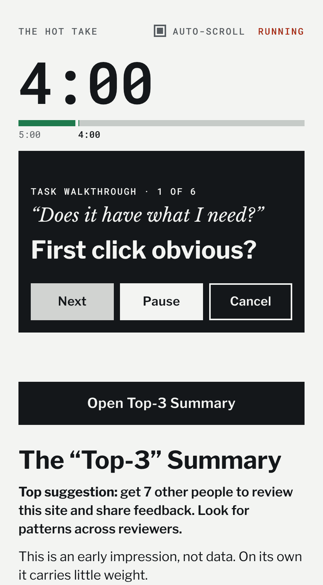
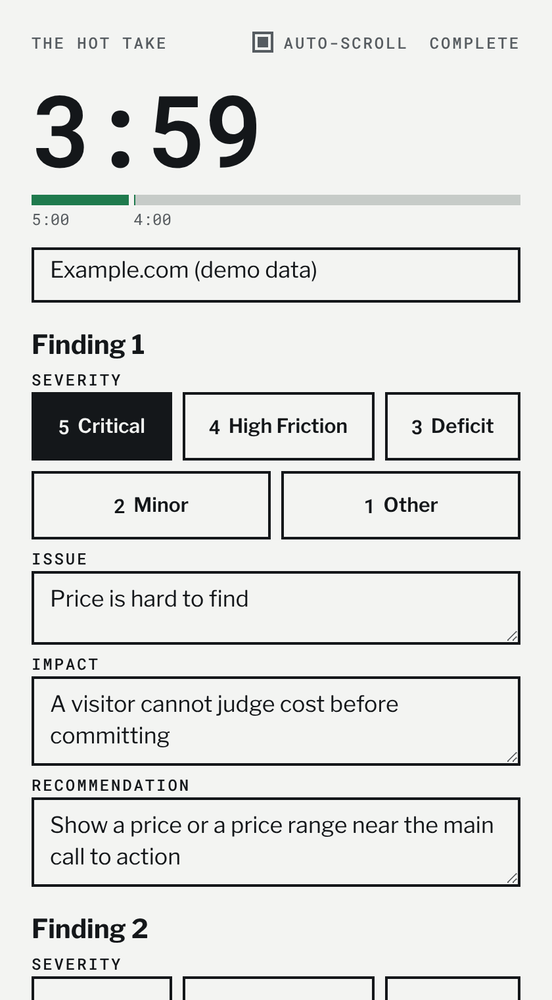

# The Hot Take

A five-minute timer, checklist and report for a quick, recorded expert website review.

**[Open the live tool](https://stunning-lollipop-d7aff8.netlify.app)** · [Report a bug](https://github.com/MarkOpalski/hot-take/issues/new/choose) · [Contribute](CONTRIBUTING.md) · [Security](SECURITY.md) · [MIT license](LICENSE)

> Expert review, not user data. Everything this tool produces is a hypothesis to test with real users.

| 1. Ready | 2. 5-second test | 3. Walkthrough | 4. Top-3 summary |
| --- | --- | --- | --- |
|  |  |  |  |

## Contents

- [What it is](#what-it-is)
- [Who it is for](#who-it-is-for)
- [Try it in one minute](#try-it-in-one-minute)
- [How a review runs](#how-a-review-runs)
- [What you get](#what-you-get)
- [Privacy](#privacy)
- [Limits](#limits)
- [Method and references](#method-and-references)
- [Run it yourself](#run-it-yourself)
- [Project layout](#project-layout)
- [Contributing](#contributing)
- [Security](#security)
- [License](#license)
- [Author](#author)

## What it is

You record yourself reviewing a website while you look at it. The Hot Take keeps time, shows one prompt at a time so your attention stays on the site, and turns your notes into a short written report.

- Counts down from 5:00
- Walks you through a 5-second test and a task walkthrough
- Collects your top three findings with a severity rating
- Exports a Markdown report you can send to the site owner

It is a single static web page. There is no account, no server and no tracking.

## Who it is for

- **Reviewers.** Human factors, UX, product and design practitioners who want a repeatable, time-boxed way to give a first impression of a service site.
- **Site owners.** People whose site is being reviewed. The report names the issue, the likely impact and a suggested next step, and says plainly that it is an early impression.
- **Contributors.** Anyone who wants to improve a small, dependency-free tool. See [CONTRIBUTING.md](CONTRIBUTING.md).

## Try it in one minute

1. Open the [live tool](https://stunning-lollipop-d7aff8.netlify.app) next to the site you want to review, such as a second window or a browser split view.
2. Press **Start**, or press the space bar.
3. Look at the site and answer each prompt out loud.
4. Press **Next** to move on. After the last check, press **Finish review**.
5. Press **Open Top-3 Summary**, fill in your three findings, and press **Download report (.md)**.

## How a review runs

One block is visible at a time. The clock runs from 5:00 down.

| Block | Time | Prompt | What you do |
| --- | --- | --- | --- |
| 5-second test | first minute | "What is this site about?" | Load the site, do not scroll, look. Then say what you saw. |
| Task walkthrough | remaining time | "Does it have what I need?" | Work through six short checks, one at a time. |
| Top-3 summary | after the clock | none | Write up your three most important findings. |

The six walkthrough checks:

1. First click obvious?
2. Labels say where they lead?
3. Dead ends?
4. How does it work?
5. What does it mean?
6. Is it expensive?

Severity scale for each finding:

| Rating | Label |
| --- | --- |
| 5 | Critical |
| 4 | High Friction |
| 3 | Deficit |
| 2 | Minor |
| 1 | Other |

## What you get

- A Markdown report (`hot-take-review-YYYY-MM-DD.md`) with findings sorted by severity. Each finding has an issue, an impact and a recommendation.
- Optional verbatim quotes from your own recording. Load a transcript (`.vtt`, `.srt` or `.txt`) and the tool suggests lines that match each finding. You review and untick any that do not fit.
- A reminder in every report that it is an early impression, with a suggested next step: have about seven other people review the site and look for patterns.

## Privacy

- No account, no backend, no analytics, no cookies.
- Everything stays in your browser. Transcripts are read on your device and never uploaded.
- Your draft is saved in your browser's `localStorage` under the key `hottake-draft`, so a refresh does not lose it. **Clear form** removes it.
- The page makes no requests to other sites. Fonts are served from this project.
- The hosted version is served by Netlify, which may log ordinary web requests such as IP address and page URL. If that matters to you, [run it yourself](#run-it-yourself).

## Limits

Read these before you act on a report.

- **One reviewer is an early impression.** A single expert, under time pressure, who may have seen the site before, produces hypotheses. Look for patterns across several reviewers before you change anything.
- **Not a replacement for user research.** It does not measure what real users do.
- **The quote finder matches wording, not meaning.** It scores overlap between your findings and each transcript sentence. It misses lines that say the same thing in different words. You make the final choice.
- **Browser testing so far is Chromium only.** It should work in current Chrome, Edge, Firefox and Safari. Screen wake lock is used where the browser supports it.
- **Accessibility target is WCAG 2.2 AA.** It has not yet been audited with assistive technology. Please report problems.

## Method and references

The Hot Take adapts existing usability inspection practice into a fixed, time-boxed routine. It is not a validated instrument.

- Lindgaard, G., Fernandes, G., Dudek, C., & Brown, J. (2006). Attention web designers: You have 50 milliseconds to make a good first impression! *Behaviour & Information Technology, 25*(2), 115–126. Visual impressions of a web page form almost immediately. This supports the idea of a very short first look. The "5-second test" itself is a practitioner method.
- Nielsen, J., & Molich, R. (1990). Heuristic evaluation of user interfaces. *Proceedings of CHI '90*, 249–256.
- Wharton, C., Rieman, J., Lewis, C., & Polson, P. (1994). The cognitive walkthrough method: A practitioner's guide. In J. Nielsen & R. L. Mack (Eds.), *Usability Inspection Methods* (pp. 105–140). Wiley.
- Spencer, R. (2000). The streamlined cognitive walkthrough method, working around social constraints encountered in a software development company. *Proceedings of CHI 2000*, 353–359.

## Run it yourself

No build step and no dependencies. You need any static file server.

```
git clone https://github.com/MarkOpalski/hot-take.git
cd hot-take
python3 -m http.server 8080
```

Open `http://localhost:8080`.

To deploy your own copy:

- **Netlify.** Connect the repository, leave the build command empty and set the publish directory to `.`. `netlify.toml` adds the security headers, including a strict Content Security Policy.
- **Other hosts.** Serve the files as they are. Copy the headers from `netlify.toml` into your host's configuration. Without them the page still works, but you lose the Content Security Policy protection.

To run the smoke test, which checks the timer, the report export and that the page makes no outside requests:

```
pip install playwright
playwright install chromium
python3 tests/smoke_test.py
```

## Project layout

| Path | Purpose |
| --- | --- |
| `index.html` | Page markup |
| `style.css` | Styles and font declarations |
| `app.js` | Timer, report builder and quote finder |
| `fonts/` | Self-hosted fonts and their licenses |
| `netlify.toml` | Static deploy settings and security headers |
| `tests/smoke_test.py` | End-to-end smoke test |
| `docs/` | Screenshots used in this README |
| `.github/` | Issue forms, pull request template and code owners |

## Contributing

Bug reports, accessibility fixes and focused improvements are welcome. Read [CONTRIBUTING.md](CONTRIBUTING.md) first. It explains the project rules: no build step, no dependencies, no outside requests, and a strict security policy.

## Security

Do not open a public issue for a security problem. Follow [SECURITY.md](SECURITY.md).

## License

- Code: [MIT](LICENSE)
- Fonts: SIL Open Font License 1.1. See [fonts/LICENSES.md](fonts/LICENSES.md).

## Author

Mark Opalski, Human Factors Engineer.
